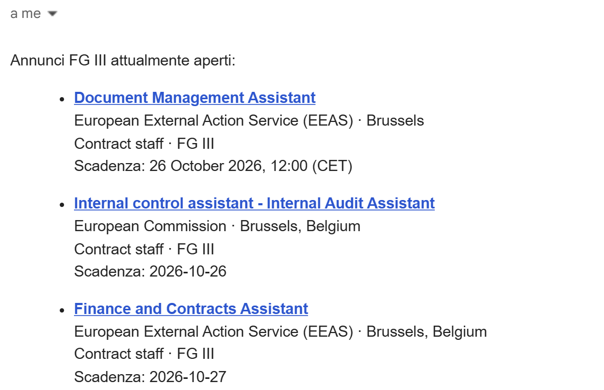
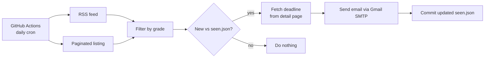
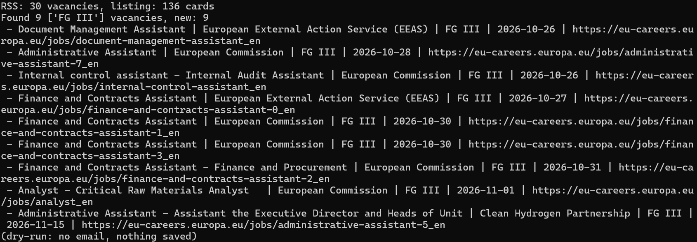

## The problem

EU institutions publish contract-agent vacancies continuously, and application windows can be short. Checking the website by hand every day is tedious and easy to forget, and missing a posting by a few days can mean missing it entirely. I wanted to be told, not to remember to look.

## The solution

A small Python script that runs by itself every day on GitHub Actions (free, no server, works with my laptop off). If there is something new for my grade, I get an email with everything I need to decide quickly: title, institution, city, contract type, grade and application deadline, sorted by deadline. If there is nothing new, it stays silent.



Example of the daily alert email (sent in Italian by my own configuration)

**Stack:** Python 3.12 (standard library only) · GitHub Actions (cron) · Gmail SMTP

## How it works



1. **Collect.** The script reads the site's RSS feed and also walks the paginated job listing. Two sources because they complement each other: the feed is stable, while the listing exposes the deadline and catches anything the feed misses.
2. **Filter.** Only vacancies matching the grade I monitor are kept (configurable, e.g. FG III only, or FG III + FG IV).
3. **Detect what is new.** A small `seen.json` file stores the vacancies already reported. Anything not in it is new. On the very first run, everything currently open is sent, so I start with a complete picture.
4. **Enrich.** For new vacancies, the deadline is read from the detail page if it was not already available.
5. **Notify.** An HTML email is sent through Gmail SMTP.
6. **Remember.** The workflow commits the updated `seen.json` back to the repository, only when it has changed.

## Design decisions

- **No external dependencies.** Standard library only (`urllib`, `smtplib`, `xml.etree`, `re`). Nothing to install, nothing to keep updated, fewer things that can break.
- **It fails loudly, not silently.** If both sources return zero vacancies, the script stops with an error. That almost always means the site layout changed, and the failed run triggers a GitHub notification. The worst outcome of a monitoring tool is to quietly stop working while you think it still does.
- **Polite scraping.** One request per second, an explicit User-Agent, one run per day, personal use only.
- **Resilient email delivery.** Up to three attempts, trying both SMTP ports (465 with SSL, 587 with STARTTLS).
- **Safe state handling.** A `concurrency` group prevents two runs from overlapping and corrupting the state file. The email is sent *before* the state is saved, so a failed send means the vacancies are reported again the next day instead of being lost.
- **Secrets never in the code.** Credentials are read from environment variables and, on GitHub, from repository Secrets.
- **Dry-run mode.** A `--dry-run` flag prints what would be sent, with no email and no state change, which made testing safe.

## Repository contents

| File | What it is |
|---|---|
| `eu_jobs_monitor.py` | The script |
| `examples/monitor.yml` | The GitHub Actions workflow I use. It lives in `examples/` so it does not run in this public repository; copy it to `.github/workflows/` in your own copy |

## Run it yourself

Try it locally (prints what it finds, sends no email, saves nothing):

```
python eu_jobs_monitor.py --dry-run
```



*Example output of a dry run.*

To run it daily on GitHub Actions:

1. Create a Google **app password** (Google account → Security → 2-step verification → App passwords).
2. Copy this repository into a **private** repository of your own, and move `examples/monitor.yml` to `.github/workflows/monitor.yml`.
3. Add these under Settings → Secrets and variables → Actions:
   - `GMAIL_USER`: the Gmail address used to send
   - `GMAIL_APP_PASSWORD`: the app password
   - `MAIL_TO`: recipient(s), comma-separated
4. Run the workflow once from the Actions tab (*Run workflow*) to test it.

To monitor other grades, edit `GRADES` in `eu_jobs_monitor.py` (e.g. `["FG III", "FG IV"]`).

## Limitations (and what I would improve)

- The listing page is parsed with regular expressions, so a layout change can break it. A proper HTML parser would be more robust; the RSS feed currently acts as the safety net.
- GitHub disables scheduled workflows after 60 days without repository activity, so it needs an occasional re-enable or a keepalive commit.
